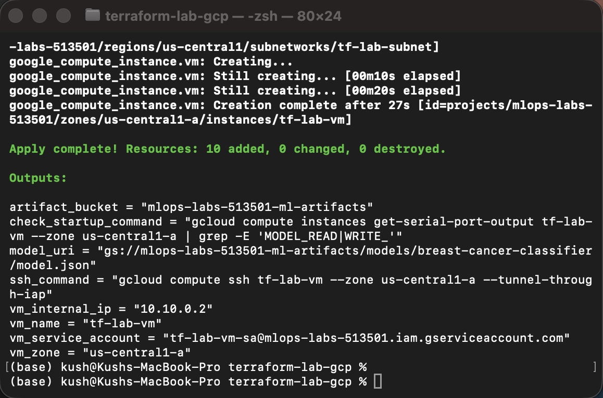
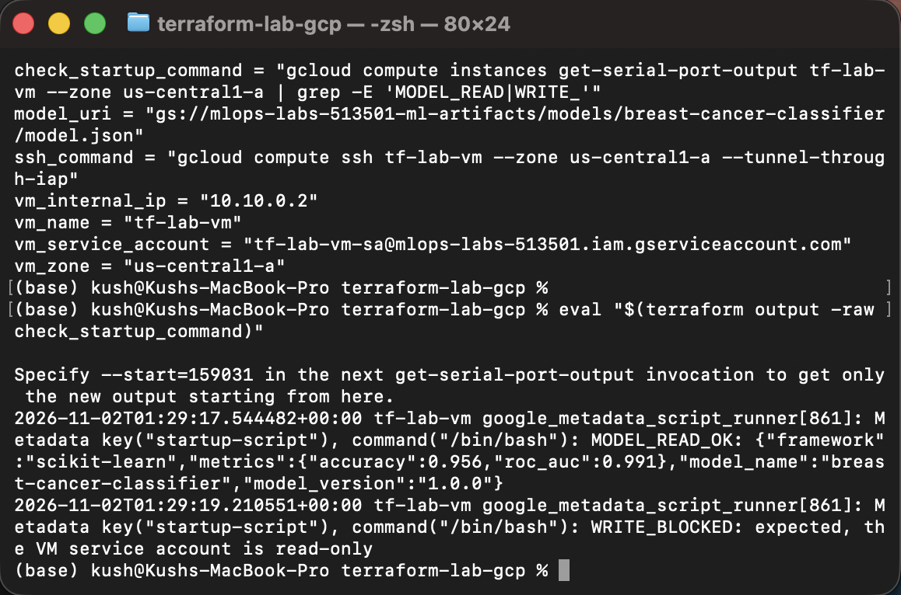
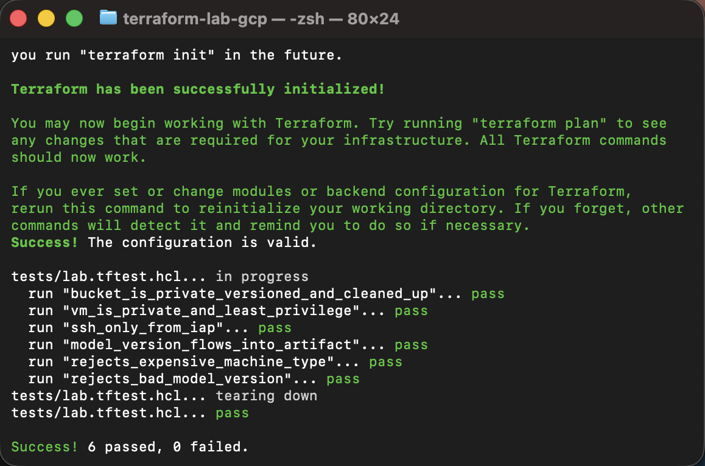
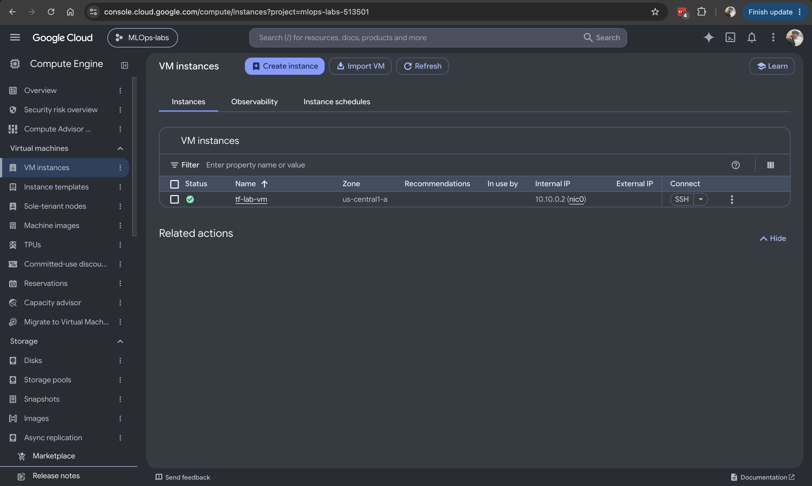
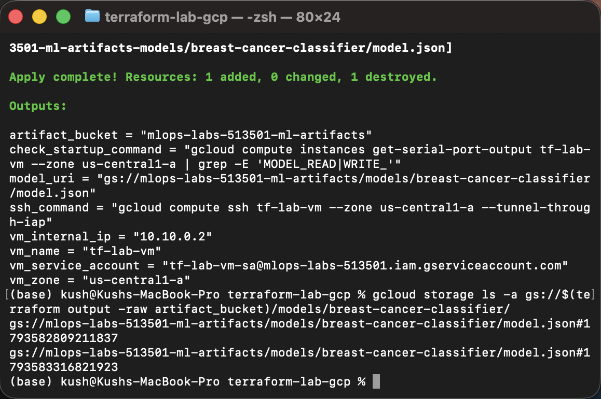

# Terraform Lab (GCP): Secure ML Artifact Environment (Lab3)

Infrastructure-as-code lab that uses **Terraform** to provision a small, secure ML environment on **Google Cloud**: a private VM, a hardened and versioned model-artifact bucket, least-privilege IAM, and **remote Terraform state stored in Cloud Storage**. It includes offline tests that run without any cloud credentials.

Built for the MLOps course (Dr. Ramin Mohammadi, Northeastern University), based on the course's [Terraform Beginner Lab (GCP)](https://github.com/raminmohammadi/MLOps/tree/main/Labs/Terraform_Labs/GCP/Lab1_Beginner).

---

## Table of Contents
- [Changes from the Original Lab](#changes-from-the-original-lab)
- [Architecture](#architecture)
- [Project Structure](#project-structure)
- [Prerequisites](#prerequisites)
- [GCP Setup (one time)](#gcp-setup-one-time)
- [Running the Lab](#running-the-lab)
- [Verifying It Works](#verifying-it-works)
- [Modifying Resources](#modifying-resources)
- [Testing](#testing)
- [Cleanup](#cleanup)
- [Troubleshooting](#troubleshooting)
- [Screenshots](#screenshots)

---

## Changes from the Original Lab

The original lab writes one `main.tf` with a hardcoded project, a VM on the `default` network, and an empty bucket, then applies and destroys it with local state. This version reworks the **Terraform configuration itself**:

| # | Area | Original lab | This version | What it does |
|---|---|---|---|---|
| 1 | **State** | Local `terraform.tfstate` file | **Remote GCS backend** (`versions.tf`) in a versioned, private bucket | State is shared, locked during applies, and every past state version can be recovered. This is the "securely store state" advice from Part 6, actually implemented. |
| 2 | **Authentication** | Downloaded service-account JSON key | `gcloud auth application-default login` | No long-lived key files on disk or at risk of being committed. |
| 3 | **Versions** | None pinned | `required_version` and provider `~> 6.0` (`versions.tf`) | Everyone runs the same Terraform/provider behavior. |
| 4 | **Configuration** | Hardcoded values in one file | 10 input variables with **validation blocks**, `terraform.tfvars`, outputs, split into files by concern | Bad inputs (expensive machine types, wrong regions, malformed versions) are rejected before anything is created. |
| 5 | **APIs** | Enabled manually in the console | `google_project_service` with `for_each` (`apis.tf`) | Terraform enables the Compute and IAM APIs itself. |
| 6 | **Image** | Hardcoded `debian-11` | `data "google_compute_image"` for the `debian-12` family | Always uses the latest patched image. |
| 7 | **Network** | `default` network (SSH open to the internet) | Custom VPC + subnet with Private Google Access + firewall allowing SSH **only from IAP** (`network.tf`) | The VM has **no public IP** and can still reach Cloud Storage. |
| 8 | **VM identity** | Default Compute Engine service account | Dedicated service account with **read-only** access to one bucket (`iam.tf`) | Least privilege: the VM can read models but cannot write or delete. |
| 9 | **VM hardening** | None | Shielded VM, OS Login, project SSH keys blocked, `allow_stopping_for_update` | Secure boot, central SSH access control, and machine-type changes without manual stops. |
| 10 | **Bucket** | Plain bucket | Versioning, uniform bucket-level access, public access prevention **enforced**, lifecycle rules (keep 3 old versions, abort failed uploads) (`storage.tf`) | Private, recoverable, and self-cleaning artifact store. |
| 11 | **Artifact** | None | Sample model object whose content and metadata follow `var.model_version` | Changing one variable publishes a new model version; old ones are kept. |
| 12 | **Labels** | Hand-written labels on one resource | Provider `default_labels` | Every resource is labeled `managed_by`, `environment`, `course` automatically. |
| 13 | **Verification** | Look in the console | Startup script that tests read (should work) and write (should fail), checked via serial output | Proves the IAM design works on the real VM. |
| 14 | **Testing** | None | `terraform test` with a **mocked Google provider** (6 tests) | Checks security settings and validations offline, with no credentials and no cost. |

---

## Architecture

```
                         ┌──────────────────── GCP project ─────────────────────┐
 Your laptop             │                                                       │
 terraform apply ──────► │  VPC tf-lab-vpc                                       │
      │                  │   └─ subnet 10.10.0.0/24 (Private Google Access)      │
      │                  │        └─ VM tf-lab-vm (e2-micro, no public IP)       │
      │                  │             │  identity: tf-lab-vm-sa                 │
      │                  │             │  role: storage.objectViewer (read-only) │
      │                  │             ▼                                         │
      │                  │  Bucket <project>-ml-artifacts                        │
      │                  │   └─ models/breast-cancer-classifier/model.json       │
      │                  │                                                       │
      └── state ───────► │  Bucket <project>-tfstate  (remote state + locking)  │
                         │  Firewall: SSH only from IAP 35.235.240.0/20          │
                         └───────────────────────────────────────────────────────┘
```

---

## Project Structure

```
terraform-gcp-lab/
├── assets/                          # README screenshots
├── terraform-lab-gcp/
│   ├── versions.tf                  # Terraform + provider versions, GCS backend
│   ├── providers.tf                 # Google provider, default labels
│   ├── variables.tf                 # inputs with validation
│   ├── apis.tf                      # enables Compute + IAM APIs
│   ├── network.tf                   # VPC, subnet, IAP-only SSH firewall
│   ├── iam.tf                       # VM service account, bucket read-only role
│   ├── storage.tf                   # artifact bucket, lifecycle, sample model
│   ├── compute.tf                   # image lookup, VM
│   ├── outputs.tf                   # bucket, model URI, VM info, check commands
│   ├── startup.sh.tftpl             # VM boot script (read/write access check)
│   ├── terraform.tfvars.example     # copy to terraform.tfvars
│   ├── .terraform.lock.hcl          # exact provider version (created by terraform init)
│   └── tests/
│       └── lab.tftest.hcl           # offline tests (mocked provider)
├── .gitignore
└── README.md
```

---

## Prerequisites

You need **Terraform**, the **Google Cloud CLI**, **Git**, and a **GCP project with billing enabled** (course credits work).

### Terraform 1.7 or newer
- **macOS:**
  ```bash
  brew tap hashicorp/tap
  brew install hashicorp/tap/terraform
  ```
- **Windows:** `winget install Hashicorp.Terraform`
- **Linux:** follow the [official install guide](https://developer.hashicorp.com/terraform/install)

Check: `terraform -version` ✅ Expected: `Terraform v1.7.0` or newer

### Google Cloud CLI
- **macOS:** `brew install --cask google-cloud-sdk`
- **Windows:** `winget install Google.CloudSDK`
- **Linux:** follow the [official install guide](https://cloud.google.com/sdk/docs/install)

Check: `gcloud --version` ✅ Expected: `Google Cloud SDK ...` (any recent version)

### Git
- **macOS:** `xcode-select --install`
- **Windows:** `winget install Git.Git`

Check: `git --version` ✅ Expected: `git version 2.x.x`

### Versions used
| Tool | Version |
|---|---|
| Terraform | ≥ 1.7.0 |
| Google provider (`hashicorp/google`) | ~> 6.0 (exact version recorded in `.terraform.lock.hcl`) |
| Google Cloud CLI | any recent release |

---

## GCP Setup (one time)

Commands are for macOS/Linux. On Windows PowerShell, replace `export PROJECT_ID=...` with `$env:PROJECT_ID="..."` and `${PROJECT_ID}` with `$env:PROJECT_ID`.

```bash
# 1. Log in (opens a browser)
gcloud auth login

# 2. Point gcloud at your project (find the ID on the GCP console home page)
export PROJECT_ID="your-project-id"
gcloud config set project ${PROJECT_ID}

# 3. Confirm billing is linked
gcloud billing projects describe ${PROJECT_ID} --format="value(billingEnabled)"
```
✅ Expected: `True`

```bash
# 4. Credentials for Terraform (no key files)
gcloud auth application-default login
gcloud auth application-default set-quota-project ${PROJECT_ID}
```
✅ Expected: `Credentials saved to file: [.../application_default_credentials.json]`

```bash
# 5. Create the bucket that will hold Terraform's state
gcloud storage buckets create gs://${PROJECT_ID}-tfstate \
  --location=us-central1 --uniform-bucket-level-access --public-access-prevention
gcloud storage buckets update gs://${PROJECT_ID}-tfstate --versioning
```
✅ Expected: `Creating gs://<project>-tfstate/...` then `Updating gs://<project>-tfstate/...`

> Why gcloud and not Terraform? Terraform can't store its state in a bucket it hasn't created yet, so the state bucket is created once, by hand.

---

## Running the Lab

```bash
git clone https://github.com/kushpatel02/terraform-gcp-lab.git
cd terraform-gcp-lab/terraform-lab-gcp

# Set your project ID for Terraform
echo "project_id = \"${PROJECT_ID}\"" > terraform.tfvars
cat terraform.tfvars
```
✅ Expected: `project_id = "<your project id>"`

### 1. Initialize (downloads the provider, connects to remote state)
```bash
terraform init -backend-config="bucket=${PROJECT_ID}-tfstate"
```
✅ Expected:
```
Successfully configured the backend "gcs"! Terraform will automatically
use this backend unless the backend configuration changes.
...
Terraform has been successfully initialized!
```

### 2. Check formatting and validate
```bash
terraform fmt -check -recursive
terraform validate
```
✅ Expected: no output from `fmt`, then `Success! The configuration is valid.`

### 3. Plan
```bash
terraform plan
```
✅ Expected (last line):
```
Plan: 10 to add, 0 to change, 0 to destroy.
```
The 10 resources: 2 API enablements, VPC, subnet, firewall, service account, bucket, model object, bucket IAM binding, VM.

### 4. Apply
```bash
terraform apply
```
Type `yes` when asked. Takes about 1–2 minutes.

✅ Expected:
```
Apply complete! Resources: 10 added, 0 changed, 0 destroyed.

Outputs:
artifact_bucket       = "<project>-ml-artifacts"
check_startup_command = "gcloud compute instances get-serial-port-output tf-lab-vm --zone us-central1-a | grep -E 'MODEL_READ|WRITE_'"
model_uri             = "gs://<project>-ml-artifacts/models/breast-cancer-classifier/model.json"
ssh_command           = "gcloud compute ssh tf-lab-vm --zone us-central1-a --tunnel-through-iap"
vm_internal_ip        = "10.10.0.x"
vm_name               = "tf-lab-vm"
vm_service_account    = "tf-lab-vm-sa@<project>.iam.gserviceaccount.com"
vm_zone               = "us-central1-a"
```

---

## Verifying It Works

Run these from `terraform-lab-gcp/`.

### 1. State is stored remotely, not on your laptop
```bash
gcloud storage ls gs://${PROJECT_ID}-tfstate/terraform-lab-gcp/state/
ls terraform.tfstate
```
✅ Expected: `gs://<project>-tfstate/terraform-lab-gcp/state/default.tfstate`, and `ls` reports **No such file or directory**.

### 2. The VM can read the model but cannot write
Wait 2–3 minutes after apply for the VM to boot, then:
```bash
eval "$(terraform output -raw check_startup_command)"
```
✅ Expected (with a timestamp prefix):
```
startup-script: MODEL_READ_OK: {"framework":"scikit-learn","metrics":{"accuracy":0.956,"roc_auc":0.991},"model_name":"breast-cancer-classifier","model_version":"1.0.0"}
startup-script: WRITE_BLOCKED: expected, the VM service account is read-only
```
A few `MODEL_READ_RETRY` lines before `MODEL_READ_OK` are normal: new IAM permissions take a minute to apply.

### 3. The VM has no public IP
```bash
gcloud compute instances describe tf-lab-vm --zone us-central1-a \
  --format="value(networkInterfaces[0].accessConfigs)"
```
✅ Expected: empty output.

### 4. The bucket is private, versioned, and has lifecycle rules
```bash
gcloud storage buckets describe gs://$(terraform output -raw artifact_bucket) \
  --format="yaml(public_access_prevention,uniform_bucket_level_access,versioning_enabled,lifecycle_config)"
```
✅ Expected: `public_access_prevention: enforced`, `uniform_bucket_level_access: true`, `versioning_enabled: true`, and two lifecycle rules (`Delete` with `numNewerVersions: 3`, `AbortIncompleteMultipartUpload`).

### 5. (Optional) SSH into the VM through IAP
```bash
eval "$(terraform output -raw ssh_command)"
```
The first time, gcloud may ask to enable the IAP API and create an SSH key; answer `Y`.

---

## Modifying Resources

Publish a new model version by changing one variable:
```bash
terraform apply -var="model_version=1.1.0"
```
✅ Expected: the plan replaces only the model object (`1 to add, 0 to change, 1 to destroy`).

Check that the old version is still kept:
```bash
gcloud storage ls -a gs://$(terraform output -raw artifact_bucket)/models/breast-cancer-classifier/
```
✅ Expected: two lines for `model.json`, each ending in a different `#<generation>` number. The older one can be restored by its generation number. After 3 newer versions exist, the lifecycle rule deletes the oldest automatically.

Try an invalid input to see validation in action:
```bash
terraform plan -var="machine_type=n2-standard-8"
```
✅ Expected: `Error: Invalid value for variable ... machine_type must be e2-micro, e2-small or e2-medium.` Nothing is created.

---

## Testing

The tests use a **mocked Google provider**: no credentials, no resources, no cost. From `terraform-lab-gcp/`, after `terraform init`:
```bash
terraform test
```
✅ Expected:
```
tests/lab.tftest.hcl... in progress
  run "bucket_is_private_versioned_and_cleaned_up"... pass
  run "vm_is_private_and_least_privilege"... pass
  run "ssh_only_from_iap"... pass
  run "model_version_flows_into_artifact"... pass
  run "rejects_expensive_machine_type"... pass
  run "rejects_bad_model_version"... pass
tests/lab.tftest.hcl... tearing down
tests/lab.tftest.hcl... pass

Success! 6 passed, 0 failed.
```

| Test | What it checks |
|---|---|
| `bucket_is_private_versioned_and_cleaned_up` | Bucket name format, versioning, public access prevention, uniform access, lifecycle keeps 3 versions |
| `vm_is_private_and_least_privilege` | No public IP, dedicated service account, read-only role, `e2-micro` default |
| `ssh_only_from_iap` | Firewall only allows the IAP range |
| `model_version_flows_into_artifact` | Changing `model_version` updates the artifact metadata |
| `rejects_expensive_machine_type` | Validation blocks `n2-standard-8` |
| `rejects_bad_model_version` | Validation blocks `v1` (not `MAJOR.MINOR.PATCH`) |

To run the tests without GCP access at all: `terraform init -backend=false && terraform test`.

---

## Cleanup

Destroy everything Terraform created:
```bash
terraform destroy
```
Type `yes`. ✅ Expected: `Destroy complete! Resources: 10 destroyed.`

The state bucket is not managed by Terraform, so remove it last:
```bash
gcloud storage rm -r gs://${PROJECT_ID}-tfstate
```

**Cost:** `e2-micro` with a 10 GB standard disk in `us-central1` is within GCP's free tier, and the buckets hold a few KB. Still, destroy everything when you're done.

---

## Troubleshooting

| Problem | Fix |
|---|---|
| `Error: Failed to get existing workspaces ... bucket doesn't exist` | Step 5 of GCP Setup wasn't run, or `PROJECT_ID` isn't set in this terminal |
| `could not find default credentials` | Run `gcloud auth application-default login` |
| `... API has not been used in project ... or it is disabled` | Wait 1–2 minutes and run `terraform apply` again; the API was just enabled |
| `Billing account for project ... is not found` | Link billing in the console under **Billing**, then retry |
| `Error 409: ... already exists` | A previous run left that resource; run `terraform destroy`, or wait a few minutes if it was just deleted |
| No `MODEL_READ_OK` line yet | The VM is still booting; wait a minute and run the check again |
| `Error acquiring the state lock` | Another apply is running, or one crashed. If you're sure nothing is running: `terraform force-unlock <LOCK_ID>` |

---

## Screenshots

**`terraform apply` output**


**VM access check (read OK, write blocked)**


**`terraform test` passing**


**Resources in the GCP console**


**New model version published (versioning keeps the old one)**

